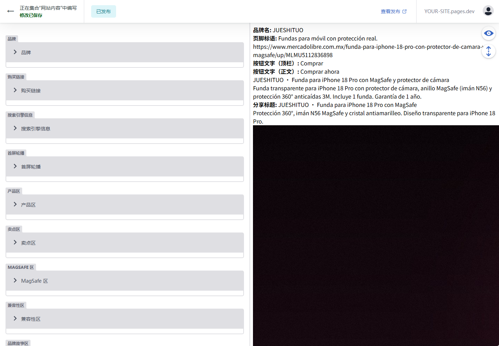

# Robin 网站 · 使用与维护说明

一页三屏的落地页：**第 1 屏手机壳 → 第 2 屏手机膜 → 第 3 屏联系方式**（聊天卡片 + 二维码 + 一键拨号）。

| | 地址 |
|---|---|
| 官网 | https://mexico-web.luyonghuang.workers.dev |
| 后台 | https://mexico-web.luyonghuang.workers.dev/admin/ |

改文字、换图片都在后台网页里点，**不用装软件、不用碰代码**。

---

## 一、进后台（给同事用，不用你的电脑）

后台是云端网页，谁在自己电脑或手机上登录都一样 —— 你电脑关掉也不影响他们改。

**第一次给某个同事开权限，做两件事：**

1. 让对方注册一个 GitHub 账号（免费，2 分钟）：https://github.com/signup
2. 你把对方加成仓库协作者：GitHub 仓库 → **Settings → Collaborators → Add people**，输入他的 GitHub 用户名
   对方会收到邮件邀请，点同意即可

**之后他自己操作：**

1. 浏览器打开 https://mexico-web.luyonghuang.workers.dev/admin/
2. 点「使用 GitHub 登录」→ 授权
3. 左侧「网站内容 → 首页」，右边就是表单
4. 改完点右上角 **Publish**，等 1～2 分钟刷新官网就能看到



> 每次保存都以**他自己的 GitHub 身份**提交，谁改了什么在仓库的 commit 记录里一清二楚。
> 两个人同时改不冲突：后保存的会覆盖前面的同一条内容。

---

## 二、换图片

| 页面位置 | 后台字段 | 规格 |
|---|---|---|
| 第 1 屏 产品图 | 第 1 屏 · 手机壳 → 产品图 | 1200×1600 PNG，透明底或白底，1 MB 以内 |
| 第 2 屏 产品图 | 第 2 屏 · 手机膜 → 产品图 | 同上 |
| 第 3 屏 二维码 | 第 3 屏 · 联系方式 → 二维码图片 | 600×600 PNG，黑白、四周留白 |

上传的新图会存进 `assets/img/uploads/`，**不会覆盖原来的图**；想换回去，把字段里的路径改回
`/assets/img/case-product.png` 就行。

图片内容要求：产品**完整、居中**，四周留 5~10% 空白，不要带文字、水印、边框、多余道具。
尺寸比例差一点页面也不会坏，只是会多一点留白。

### AI 生图提示词（把手机拍的图变成 1200×1600 透明底）

```
把这张产品图做成电商主图：去掉背景，改成完全透明底；只保留产品本身，产品完整、居中，四周留出约 8% 的透明空白；输出竖版 3:4、1200×1600 像素；保持产品的颜色、材质、光影和细节不变；不要添加任何文字、水印、阴影、边框或装饰。
```

英文版（国外工具用这段）：

```
Turn this product photo into a transparent-background product image: remove the background completely, keep only the product, fully visible and centered with about 8% empty transparent margin, portrait 3:4 at 1200×1600 px, preserve the exact colors, materials, lighting and details. Do not add text, watermark, shadow, border or decorations.
```

做不出透明底也没关系：**白底 1200×1600 的 PNG 一样能用**（版块本来就是白底）。

---

## 三、改文字

后台里从上到下就是页面从上到下的顺序：

| 后台分区 | 改的是 |
|---|---|
| 品牌 → 品牌名 | 左上角 `Robin` |
| 顶栏按钮 | 右上角 `Learn More` |
| 搜索引擎信息 | 浏览器标签页标题、搜索结果简介、分享到 WhatsApp/Facebook 的标题和图 |
| 第 1 屏 · 手机壳 | 小标题、大标题、副标题、三条卖点、按钮文字、按钮链接、产品图 |
| 第 2 屏 · 手机膜 | 同上 |
| 第 3 屏 · 联系方式 | 聊天窗口标题、聊天气泡、打电话按钮、电话号码、二维码、网址、服务时间、页脚版权 |

**填写小贴士**

- **大标题**里想换行就**按回车**，页面会自动换行显示
- **三条卖点**是「一行一条」，编辑框里敲几行就显示几条
- **聊天气泡**可以加、可以删；「谁说的」选**对方**就是左边白气泡，选**我**就是右边橙色气泡
- **电话号码**只填一次（例如 `+52 55 1234 5678`），「Call Now」按钮的拨号链接会自动跟着变
- 页脚年份会自动更新，不用管

---

## 四、联系方式（第 3 屏）

- 电话：后台「第 3 屏 · 联系方式 → 电话号码」，按钮点了直接拨号
- 二维码：`600×600 PNG`，扫码打开 `www.f-lexin.com`（网址文字也在后台里改）
- 服务时间、网址文字都在同一个分区

---

## 五、常见问题

1. **改完刷新没变化？** 后台保存后要等 Cloudflare 重新部署，通常 1～2 分钟。按 `Ctrl + F5` 强制刷新再看。
2. **点「使用 GitHub 登录」报错、或提示没权限？** 说明这个 GitHub 账号还没被加成仓库协作者，找管理员加。
3. **图片上传后没显示？** 检查格式（PNG）、大小（1 MB 以内），然后 `Ctrl + F5`。
4. **两个人一起改会打架吗？** 不会报错，但同一条内容以最后保存的为准；建议不同时改同一屏。
5. **改了样式/页面结构看不到变化？** CSS 和 JS 文件名不变，浏览器可能还留着旧文件；
   按 `Ctrl + Shift + R` 强制刷新一次。以后改样式时把 `index.html` 里 `style.css?v=2` 的
   `v=2` 改成 `v=3` 就能让所有访客立刻拿到新文件。
6. **改坏了想退回？** 让我帮你看仓库的提交记录，可以回滚到任意一次保存之前。

---

## 六、给技术同学

### 结构

```
index.html              三屏结构（文案默认值写在这里，后台改的内容会覆盖它）
content/site.json       ★ 后台编辑的数据源
admin/                  Decap CMS 后台（/admin/）
admin/config.yml        后台表单定义（中文字段、提示、上传目录）
src/worker.js           Worker：/api/auth、/api/callback 登录代理，其余交给静态资源
wrangler.jsonc          Worker 部署配置（main + assets）
assets/js/content.js    读 content/site.json 并填充页面（JS 失败时用 HTML 里的默认文案）
assets/js/main.js       顶栏状态、滚动平滑、入场动画、年份
assets/css/style.css    样式（三屏 100svh + scroll-snap）
assets/img/             case-product.png / film-product.png / contact-qr.png
assets/img/uploads/     后台后台上传的新图片
_headers                缓存与安全头（Workers 静态资源同样支持）
.assetsignore           不随站点上传的仓库文件
_preview/               预览截图，不对外
```

### 本地预览

```bash
python -m http.server 8080          # 打开 http://localhost:8080
npx decap-server                    # 另开一个终端，后台免登录编辑本地文件
```

### 部署

线上是 **Worker + 静态资源**，不是 Pages（Pages Functions 在 Workers 上不执行，所以登录代理写在
`src/worker.js` 里）。

后台保存 → 提交到 GitHub → Workers 自动重新部署，所以 **Worker 必须连上仓库**：

1. Cloudflare 控制台 → Workers & Pages → `mexico-web` → Settings → Build → Connect
2. 仓库 `AAAAmoyuan/Mexico_web`，分支 `main`，构建命令留空，**部署命令 `npx wrangler deploy`**

也可以本机手动发布：`npx wrangler login` 然后 `npx wrangler deploy`。

### 一次性配置（已做完就不用管）

1. **GitHub OAuth App**：https://github.com/settings/applications/new
   - Homepage URL：`https://mexico-web.luyonghuang.workers.dev`
   - Authorization callback URL：`https://mexico-web.luyonghuang.workers.dev/api/callback`
2. **Worker 变量**（Settings → Variables and Secrets）
   - `GITHUB_CLIENT_ID`（Text）
   - `GITHUB_CLIENT_SECRET`（**Secret**）
3. 换域名时：`admin/config.yml` 里 `base_url`、`site_url`、`display_url` 三处，加上 OAuth App 的
   callback 地址要一起改

### 缓存策略

`_headers` 里分区设置，别再把 CSS/JS 设成长期缓存（文件名不变，改了用户看不到）：

| 路径 | Cache-Control | 原因 |
|---|---|---|
| `/assets/css/*`、`/assets/js/*` | `max-age=0, must-revalidate` | 文件名固定，必须每次校验 |
| `/assets/img/*` | `max-age=31536000, immutable` | 后台换图会生成新文件名 |
| `/content/*` | `max-age=0, must-revalidate` | 后台改的字要立刻生效 |
| `/admin/*` | `no-store` | 后台不能缓存 |

改 CSS/JS 后如果想让已缓存的老访客立刻更新，把 `index.html` 里的 `?v=2` 递增一位。

### 注意

- 三屏结构固定 3 屏；后台只能改内容，不能加第 4 屏
- `content/site.json` 里图片路径以 `/` 开头（从站点根目录算），后台选图后自动是 `/assets/img/uploads/...`
- `.assetsignore` 里的东西（README、_preview、src、wrangler.jsonc 等）不会出现在网站上
